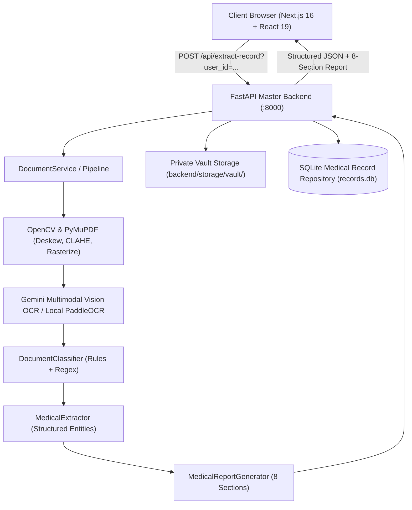

# DR. DOOM — Clinical Health Intelligence & Multimodal Medical AI Platform

[](https://github.com/placeholder/dr-doom/actions)
[](https://nextjs.org/)
[](https://react.dev/)
[](https://fastapi.tiangolo.com/)
[](https://python.org/)
[](#)

---

## 1. Project Overview & Implemented Features

**DR. DOOM (Dr. DOOM)** is an enterprise clinical health intelligence platform combining computer vision OCR, structured clinical information extraction, an 8-section evidence-grounded report explanation engine, multilingual medical translation, and a persistent personal medical records vault.

### Core Implemented Capabilities

1. **Multimodal Clinical Vision OCR**:
   - Evaluates digital text directly from searchable PDFs with 100% character fidelity.
   - Applies OpenCV image preprocessing (adaptive skew detection, deskewing without text clipping, CLAHE contrast enhancement, and bilateral denoising for faint or scanned lab sheets).
   - High-resolution scanned document rasterization at 300 DPI via PyMuPDF.
   - Dual-engine fallback architecture: Evaluated local PaddleOCR PP-OCRv5 alongside Gemini Multimodal Vision OCR.

2. **Accurate 8-Section Medical Explanation Engine**:
   - Zero-hallucination policy: Missing medications or diagnoses explicitly state *"No active medications/diagnoses identified in this document"*; never fabricates prescriptions.
   - Complete 8-section standardized order:
     1. `🧬 1. Disease Condition & Health Status`
     2. `📊 2. Key Diagnostic Findings & Lab Metrics`
     3. `💊 3. Medication Guide & Prescription Protocol`
     4. `🥗 4. Clinical Diet, Nutrition & Lifestyle Directives`
     5. `⚠️ 5. Critical Warning Signs & Escalation Triggers`
     6. `❓ 6. Recommended Questions for Your Doctor`
     7. `📅 7. Follow-Up Roadmap & Diagnostic Monitoring`
     8. `⚖️ 8. Clinical Governance & Medico-Legal Disclaimer`
   - Meets 150+ patient-facing word count standards measured strictly on substantive explanation text (excluding headers and metadata).

3. **Multilingual Clinical Translation & Speech Synthesis**:
   - Native Indic Unicode generation for English, Telugu (తెలుగు), Hindi (हिंदी), Tamil (தமிழ்), and Tenglish (Telugu phonetically in Latin script).
   - Real-time client-side language switching re-evaluates the verified document and displays native script throughout all sections.
   - Text-to-Speech (TTS) with play, pause, resume, and stop controls. Speech synthesis automatically starts at the patient-facing explanation, stripping internal metadata, ABHA numbers, and model identifiers.

4. **Personal Medical Records Vault & Longitudinal Tracking**:
   - Private SQLite-backed persistent repository (`records.db`) with SHA-256 document deduplication.
   - Isolated physical document storage inside a protected server vault (`backend/storage/vault/<user_id>/`).
   - Server-side access control preventing Insecure Direct Object References (IDOR).
   - Multi-document comparison engine tracking canonical biomarkers (e.g., Hemoglobin, Fasting Blood Sugar, Creatinine) chronologically with percentage changes and status transitions.

5. **Medical Awareness & Clinical Disease Library**:
   - Built-in clinical encyclopedia indexing the top 50 common conditions across infectious, cardiovascular, metabolic, gastrointestinal, dermatological, and psychiatric domains (`backend/disease_service.py`).
   - Educational 3D anatomical viewer integrations and interactive health assessment modules.

6. **Cinematic Glassmorphism Authentication UI**:
   - Responsive cinematic emerald-and-gold medical sanctuary background (`/login-bg.webp`) with dark gradient overlay.
   - Translucent glassmorphism login and signup cards with accessible contrast, input validation, and password visibility toggles.
   - Demo access mode alongside Google and Microsoft OAuth flows.

---

## 2. Architecture & Data Flow



---

## 3. Repository Structure

```
bytexl_hackathon/
├── .github/
│   └── workflows/
│       └── ci.yml               # Automated GitHub Actions test & build pipeline
├── backend/
│   ├── app.py                   # FastAPI application & REST route definitions
│   ├── disease_service.py       # Top 50 clinical diseases knowledge engine
│   ├── requirements.txt         # Python package dependencies
│   ├── .env.example             # Backend environment template (zero secrets)
│   ├── services/
│   │   ├── document_classifier.py     # Document type classification & safety gates
│   │   ├── document_manager.py        # Document lifecycle, caching & access control
│   │   ├── document_service.py        # Central orchestrator for upload and analysis
│   │   ├── image_preprocessor.py      # OpenCV deskewing, CLAHE & noise reduction
│   │   ├── medical_extractor.py       # Lab parameter & medication extraction
│   │   ├── medical_record_repository.py # SQLite database repository & vault manager
│   │   ├── medical_report_engine.py   # 8-section report generation & TTS cleaner
│   │   ├── ocr_engine.py              # OCR engine abstraction & PaddleOCR loader
│   │   └── pdf_processor.py           # Digital PDF extractor & 300 DPI rasterizer
│   ├── storage/
│   │   ├── records.db           # SQLite database (git-ignored)
│   │   └── vault/               # Secure document vault (git-ignored)
│   └── tests/
│       ├── test_accurate_medical_reports.py # 8-section & multilingual unit tests
│       ├── test_medical_ocr.py              # OCR preprocessing & rejection tests
│       └── test_medical_records.py          # IDOR, search, filter & compare tests
├── docs/
│   └── disease_reference_data.md # Reference clinical tables for top 50 diseases
├── frontend/
│   ├── src/
│   │   ├── app/
│   │   │   ├── layout.tsx       # Root layout & Google Fonts configuration
│   │   │   ├── page.tsx         # Landing homepage
│   │   │   ├── chat/page.tsx    # Clinical AI consultation workspace
│   │   │   ├── copilot/page.tsx # Medical Copilot & interactive assistance
│   │   │   ├── login/page.tsx   # Cinematic architectural glassmorphism login
│   │   │   ├── signup/page.tsx  # Cinematic architectural glassmorphism registration
│   │   │   ├── records/page.tsx # Personal Medical Records Dashboard
│   │   │   └── profile/page.tsx # User profile, health metrics & ABHA setup
│   │   ├── components/
│   │   │   ├── ChatbotWorkspace.tsx        # Chatbot workspace & document analyzer
│   │   │   ├── MedicalRecordsDashboard.tsx # Vault dashboard, filters & comparator
│   │   │   └── ...
│   │   └── lib/
│   │       ├── api.ts           # Centralized API configuration (NEXT_PUBLIC_API_URL)
│   │       └── utils.ts         # Utility helpers
│   ├── public/
│   │   ├── login-bg.webp        # Optimized cinematic green-gold background (WebP)
│   │   ├── login-bg.jpg         # Fallback JPEG background
│   │   └── ...
│   ├── next.config.ts           # Next.js configuration & HTTP security headers
│   ├── package.json             # Frontend dependencies & scripts
│   └── .env.example             # Frontend environment template
├── .gitignore                   # Hardened gitignore protecting secrets, DBs & vaults
├── .env.example                 # Root environment template
└── README.md                    # Project documentation
```

---

## 4. Prerequisites & Supported Runtime Versions

| Component | Minimum Version | Recommended Version |
| :--- | :--- | :--- |
| **Node.js** | `>= 20.0.0` | `20.x` or `22.x LTS` |
| **npm** | `>= 10.0.0` | `10.8+` |
| **Python** | `>= 3.11.0` | `3.11.x` |
| **Operating System** | Windows 10/11, Ubuntu 22.04+, macOS 13+ | Cross-platform |

---

## 5. Local Development Setup

### Clone the Repository
```bash
git clone <repository_url>
cd bytexl_hackathon
```

---

## 6. Dependency Installation Commands

### Backend Virtual Environment & Packages
```bash
cd backend
python -m venv .venv

# Windows Powershell:
.\.venv\Scripts\Activate.ps1

# Linux / macOS:
source .venv/bin/activate

pip install --upgrade pip
pip install -r requirements.txt
```

### Frontend Dependencies
```bash
cd ../frontend
npm install
```

---

## 7. Environment Variable Setup

### Backend (`backend/.env`)
Create `backend/.env` from the provided template:
```bash
cp backend/.env.example backend/.env
```
Populate your Google Gemini API key:
```env
GEMINI_API_KEY=your_gemini_api_key_here
ALLOWED_ORIGINS=http://localhost:3000,http://127.0.0.1:3000
HOST=0.0.0.0
PORT=8000
STORAGE_DIR=storage
```

### Frontend (`frontend/.env.local`)
Create `frontend/.env.local`:
```bash
cp frontend/.env.example frontend/.env.local
```
Configure the API endpoint:
```env
NEXT_PUBLIC_API_URL=http://localhost:8000
```

---

## 8. Database Creation & Migration Instructions

The platform uses an embedded SQLite database managed by `MedicalRecordRepository`.
- **Automatic Initialization**: On backend startup, the database file (`backend/storage/records.db`) and necessary indexes (`idx_records_user_id`, `idx_records_category`, `idx_records_upload_ts`, `idx_records_fingerprint`) are created automatically if they do not exist.
- **Vault Directory**: The storage vault (`backend/storage/vault/`) is provisioned automatically with subdirectories per authenticated user.

---

## 9. Startup Instructions

### 1. Launch Backend Server
From the `backend` directory with the virtual environment activated:
```bash
python -m uvicorn app:app --host 0.0.0.0 --port 8000 --reload
```
Verify the health check endpoint:
```bash
curl http://localhost:8000/health
# Response: {"status":"online","service":"DR. DOOM Production Medical Document AI & Master Backend",...}
```

### 2. Launch Frontend Dev Server
From the `frontend` directory:
```bash
npm run dev
```
Open `http://localhost:3000` in your web browser.

---

## 10. Testing, Linting & Build Commands

### Backend Automated Test Suite
Run the 23-test unit and integration test suite:
```bash
# From workspace root:
& ".\backend\.venv\Scripts\python.exe" -m unittest discover -s backend/tests -v

# Or from backend directory:
python -m unittest discover -s tests -v
```
All 23 tests cover:
- CBC report verification & zero-fabrication rules.
- 8-section report generation & structure.
- Genuine Indic multilingual generation (Telugu, Hindi, Tamil, Tenglish).
- Strict 150-word patient-facing narrative threshold.
- Non-medical image rejection (zero false diagnoses).
- TTS speech synthesis text sanitation.
- OpenCV skew correction and CLAHE contrast enhancement.
- IDOR access control & user isolation boundaries.
- Search, filter, sorting, and longitudinal comparison.
- File deletion and physical vault cleanup.

### Frontend Production Build
```bash
cd frontend
npm run build
```

---

## 11. Production Deployment Instructions

### Option A: Vercel (Frontend) + Cloud Run / Render (Backend)

1. **Frontend on Vercel**:
   - Set Root Directory to `frontend`.
   - Set Build Command to `npm run build`.
   - Add Environment Variable: `NEXT_PUBLIC_API_URL=https://your-backend-domain.com`.

2. **Backend on Google Cloud Run or Docker**:
   - Create a container using Python 3.11-slim.
   - Set Environment Variables: `GEMINI_API_KEY`, `ALLOWED_ORIGINS=https://your-frontend-domain.vercel.app`.
   - Expose port `8000` and run `uvicorn app:app --host 0.0.0.0 --port 8000`.

---

## 12. External Service & AI Provider Configuration

- **Google Gemini API**: Configured via `GEMINI_API_KEY`. Supported model fallbacks:
  - `gemini-flash-lite-latest` (fast inference & multilingual generation)
  - `gemini-3.5-flash-lite`
  - `gemma-4-26b-a4b-it`
  - `gemini-3.8-flash`
- **Speech Synthesis (Web Speech API)**: Uses native browser voices (`Google हिन्दी`, `Google తెలుగు`, `ta-IN`, `en-US`) without external third-party API dependencies.

---

## 13. Security & Privacy Considerations

1. **Patient Data Isolation**:
   - All record queries and file downloads enforce strict server-side `user_id` ownership verification.
   - Cross-user data leakage and IDOR vulnerabilities are explicitly guarded against.

2. **Local Vault Protection**:
   - Raw patient uploads are stored outside the public document root with randomized filenames.
   - Physical document vault and SQLite database are excluded from version control via `.gitignore`.

3. **HTTP Security Headers**:
   - Configured in `frontend/next.config.ts`:
     - `X-Content-Type-Options: nosniff`
     - `X-Frame-Options: DENY`
     - `X-XSS-Protection: 1; mode=block`
     - `Referrer-Policy: strict-origin-when-cross-origin`
     - `Permissions-Policy: camera=(), microphone=(self), geolocation=()`

4. **Zero-Fabrication Clinical Policy**:
   - DR. DOOM enforces clear boundaries between extracted facts and educational health guidance.
   - The platform includes mandatory medico-legal disclaimers and explicitly advises consulting certified physicians before altering treatment regimens.

---

## 14. Medico-Legal Disclaimer

DR. DOOM is an educational and clinical documentation assistance tool. It does not provide certified medical diagnoses or replace consultations with licensed healthcare providers. Patients must always discuss diagnostic findings, prescription changes, and symptom exacerbations directly with a qualified medical professional.
